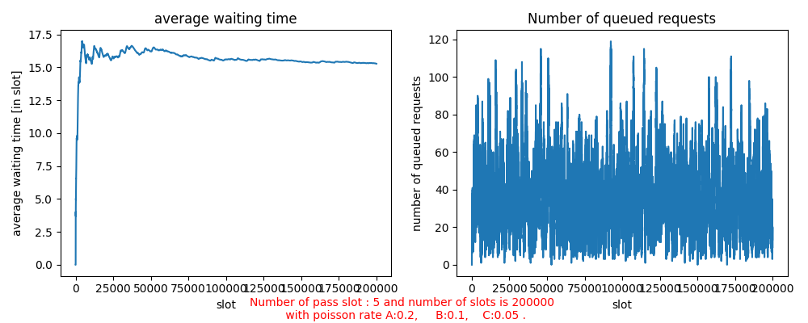

# Surgical Request Allocation with Deferred Acceptance

**A game-theoretic matching of patients to hospitals. The project simulates Poisson-arriving surgery requests and assigns them to three medical centers with the Deferred Acceptance (Gale–Shapley) algorithm, with and without letting requests wait.**


## Problem

Three medical centers (*a*, *b*, *c*) each perform three surgery types (*A*, *B*, *C*).

- **Service times** are random with means of 2, 5 and 10 hours by type. Each center operates at a different rate multiplier (1, 1/2, 1/3) for each surgery, so the same operation can take up to three times longer elsewhere.
- **Preferences conflict.** Patients rank centers by *shorter completion time*. Centers rank requests by *higher fee* (2, 7 and 5 units, permuted across centers).
- **Arrivals** of types *A*, *B* and *C* follow independent Poisson processes with rates 0.20, 0.10 and 0.05 per hour.
- **Matching** runs once per 8-hour slot on a single shared queue with Deferred Acceptance.

The project studies two settings:

1. **No waiting.** A request that is not matched in its slot is lost.
2. **Waiting allowed.** A request may pass up to *K* slots (`pass_slot`) to hold out for a better center.

The full statement is in [`docs/problem-statement.pdf`](docs/problem-statement.pdf), and the results are in [`docs/report-fa.pdf`](docs/report-fa.pdf) (Persian).

## Results

Simulation over 200,000 slots with `pass_slot = 5`:



The average waiting time settles at about 15 slots. The queue length stays bounded at around 20–60 requests, peaking at about 120, so the system stays stable at these arrival rates.

## Repository structure

```text
.
├── src/
│   └── simulate_allocation.py   # arrivals, preference lists, DA matching, metrics and plots
├── results/
│   └── queue-200000-slots.png
└── docs/
    ├── problem-statement.pdf
    ├── project-brief.pdf
    └── report-fa.pdf
```

## Running

```bash
cd src
pip install numpy matplotlib
python simulate_allocation.py
```

The inputs (`Num_slot_list`, `pass_slot` and the Poisson rates) are at the top of the script.
The script writes its figure and log to the current folder, and it **deletes any existing `.txt` and `.png` files there first**, so run it from `src/`.

## Context

Course project for *Game Theory*, M.Sc. at Sharif University of Technology.

## Author

**Mohammad Javad Amin** · [GitHub](https://github.com/mj-amin-ece)
